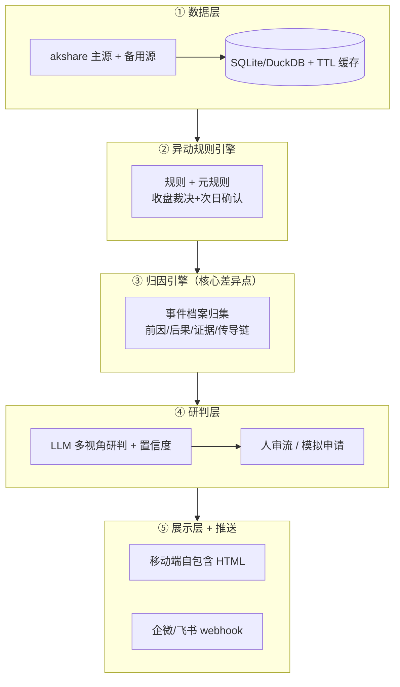

# A-Share Anomaly Prober（A 股异动前因后果探测器）

> 一个面向 A 股的开源工具：自动探测大盘 / 个股 / 板块的**异动**信号，归集「前因后果」事件档案，
> 并由 LLM 生成多视角研判，最终经**人工审批**辅助投资研判。不自动下单，只做辅助决策。

---

## 项目定位

用户需要一个能回答「**这只票 / 这个板块今天为什么动、动了之后会怎样**」的工具。
市面上同类开源方案或协议不清、或依赖重基建（通达信 / MySQL / Redis / 本地浏览器），
且普遍**缺少事件归因能力**，因此本项目选择**从零自研**：轻量栈、事件档案可追溯、不绑定任何重基建。

核心差异点在于 **③ 归因引擎**：异动触发时自动归集结构化的「事件档案」，每条证据带
「支持 / 反证」两栏，并版本化留痕，为研判提供可追溯的依据。

## 核心特性

- **五层架构**：数据层 → 异动规则引擎 → 归因引擎 → 研判层（含人审）→ 展示层 + 推送。
- **轻量栈，拒绝重基建**：数据源以 `akshare` 为主、腾讯 / 东财直连备用；本地用 SQLite / DuckDB + TTL 缓存，无 MySQL / Redis / 客户端依赖。
- **同一时间轴的外围视角**：港股 / 美股指数、A50 期货、汇率、隔夜大宗与 A 股异动对齐同一条时间轴。
- **大盘看板为默认页**：`prober dashboard` 生成 `outputs/index.html`（6 大指数 / 涨跌家数 / 板块资金流 TOP / 涨跌停 / 外围 / 近期异动），手机打开即是总览，`prober serve` 起服务时默认页指向它。
- **红涨绿跌移动端 HTML**：自包含单文件 HTML（涨 `#d70015` / 跌 `#008a3e`），便于手机查看；告警走企业微信群机器人 / 飞书 webhook。
- **个股支持名称 / 代码指定**：`--symbol` 接受 `600519`、`sh600519`、`600519.SH`、`贵州茅台`、`茅台` 等形态；有歧义时用 `prober search` 列出候选。
- **监控名单自助管理（零硬编码）**：代码中不写死任何个股。名单真源是本地库 `user_watchlist` 表——`prober serve` 后在看板页「监控列表」卡片输入名称/简称/代码即可添加（歧义时给候选点选）、可删除、可暂停/恢复；`prober watchlist` 提供等价命令行。config `[watchlist]` 仅在库为空时兜底。
- **回测复核**：`prober backtest` 用真实历史日线回放**线上同一套规则类**，统计 T+1/T+3/T+5/T+10 前向收益并对照「无信号日基线胜率」；无法用日线回放的规则（板块资金流/竞价等）如实列入 skipped_rules——不做假复核。
- **LLM 多视角研判 + 人审流**：基于 OpenAI 兼容接口（如 DeepSeek）生成「持有方 vs 旁观方」双视角研判与置信度；结论产出「模拟申请」，必须经本人批准，不直接下单。
- **开源规范**：MIT 许可，标准项目组织（README / LICENSE / pyproject.toml / 清晰目录 / docs）。

## 架构总览



> 详细设计见 [`docs/ARCHITECTURE.md`](docs/ARCHITECTURE.md)，数据源清单见 [`docs/DATA_SOURCES.md`](docs/DATA_SOURCES.md)，实施计划见 [`docs/PLAN.md`](docs/PLAN.md)。

## 快速开始

```bash
# 1. 安装（推荐：部署脚本，按 lock 精确装依赖）
bash scripts/setup_env.sh          # Linux / macOS；Windows 手动步骤见下
pip install -e ".[dev]"            # 或：开发模式安装

# 2. 配置（复制示例，填入 LLM / webhook 凭据）
cp config.example.toml config.toml

# 3. 生成大盘看板（默认页）→ outputs/index.html
prober dashboard

# 4. 起本地服务，手机 / 浏览器打开默认页即大盘总览
prober serve --port 8000     # http://127.0.0.1:8000/

# 5. 按名称或代码查标的（名称解析需联网拉取一次 A 股名单，缓存 24h）
prober search 茅台
prober search 600519

# 6. 单标的完整闭环：异动 → 归因 → 研判 → 人审 → 渲染
prober run --symbol 贵州茅台 --date 2026-09-30   # 亦可 600519 / sh600519 / 600519.SH
prober approve --id REQ-xxxx --yes --approver 我

# 7. 监控名单：页面自助管理（推荐）或命令行
prober serve --port 8000        # 打开默认页 → 「监控列表」卡片增删/暂停/恢复
prober watchlist --add 茅台      # 命令行等价操作（支持名称/简称/代码）
prober watchlist --pause 600519 # 暂停（保留名单，不再扫描）
prober watchlist                # 查看名单

# 8. 推送到企业微信 / 飞书（webhook 在页面「⚙️ 设置」或 config.toml 配置）
prober push --title "异动警报" --content "..." --level alert
```

### 页面自助配置（LLM / 推送 / 调度）

`prober serve` 后打开默认页，展开底部 **「⚙️ 设置」** 卡片即可在线修改，
**改完即生效，无需重启**：

| 配置段 | 可改项 | 说明 |
|---|---|---|
| LLM | base_url / model / api_key / temperature / max_tokens / timeout | 留空 api_key 表示保持不变 |
| 推送 | 企微 webhook / 飞书 webhook+secret / enabled / timeout | webhook 需 https |
| 调度 | 开关 / 扫描时间（HH:MM） / 推送 / 刷新看板 | 时间格式非法会被拒绝 |

- **优先级**：页面保存的配置（本地库）> `config.toml`；点「恢复默认」删除该段覆盖、回退配置文件。
- **秘密安全**：api_key / webhook 等敏感字段在页面上**永不回显明文**（只显示「已配置」+ 脱敏掩码），明文只在提交时写入本地库、不落日志。
- 校验失败的段整体拒绝（部分成功语义：合法段仍会保存，非法段不落库并提示原因）。

### 全部子命令

| 命令 | 作用 |
|---|---|
| `dashboard` | 生成大盘数据看板（`outputs/index.html`，默认页） |
| `serve` | 本地静态服务，默认页指向看板；无看板时自动生成 |
| `search` | 按名称 / 简称 / 代码模糊搜索标的，用于确认代码与消歧 |
| `run` | 单标的闭环：异动 → 归因 → 研判 → 人审 → 渲染 |
| `approve` | 批准 / 驳回研判申请并重渲染 |
| `render` | 从本地库取事件档案渲染 HTML |
| `push` | 向已配置通道（企业微信 / 飞书）推送消息 |
| `similar` | 按事件 ID 检索本地库中的相似历史案例（相似度 + 匹配维度说明） |
| `backtest` | 历史日线回测复核异动规则（前向收益 vs 无信号日基线） |
| `schedule` | 定时调度：收盘后自动扫描 watchlist → 推送 → 刷新看板（`--once` 立即跑一轮） |
| `watchlist` | 监控名单管理：`--add` / `--remove` / `--pause` / `--resume`（真源为本地库） |
| `version` / `status` | 版本与运行状态 |

> **数据缺口纪律**：任何一项数据取不到，一律留空并写入看板 / 档案的 `gaps` 字段，
> 在页面上显眼列出——**不以 0 或估算值冒充实测数据**。

## 版本锁定与升级注意事项（akshare 等）

**为什么要锁版本**：akshare 的函数名随版本剧烈变动（在 1.18.84 上实证：
`stock_dt_pool_em`、`stock_us_spot_em` 等旧名均已不存在，跌停池实际为
`stock_zt_pool_dtgc_em`、美股指数用 `index_global_spot_em`）。本项目所有
数据源调用都基于 1.18.84 的实测函数名——**未经验证的新版本可能导致采集静默失败**。

**锁定机制（三处一致）**：

| 位置 | 内容 | 作用 |
|---|---|---|
| `pyproject.toml` | `akshare>=1.18.84,<1.19` | 上界锁，阻止小版本漂移 |
| `requirements.lock.txt` | 全量依赖精确版本（含 akshare/pandas/numpy） | 可复现部署基线 |
| `scripts/setup_env.sh` / `Dockerfile` | 一律按 lock 安装，本包 `--no-deps` | 保证部署环境与验证环境一致 |

首次部署推荐 `bash scripts/setup_env.sh`（自动 venv + 锁定安装 + 版本核对 + 冒烟）。
容器部署用仓库根的 `Dockerfile`。Windows 手动安装：`python -m venv .venv` →
激活 → `pip install -r requirements.lock.txt` → `pip install --no-deps -e .`。

**升级 akshare 的检查清单**（缺一步都可能引入静默故障）：

1. **候选函数链实测**：升级后先 `dir(ak)` 核实本项目用到的每个函数名是否存在
   （数据源清单见 `docs/DATA_SOURCES.md`），凭记忆或旧文档猜必错；
2. **全量测试**：跑 `pytest -q`（务必换新的 basetemp 目录），0 failed 才继续；
3. **真数据冒烟**：`prober dashboard` 生成看板并核对 gaps 是否新增；
   `prober run --symbol 贵州茅台` 跑一只票的完整闭环；
4. **双源口径核对**：东财 / 新浪两源对同一标的的数据差异是否仍在历史噪声范围；
5. **回滚预案**：升级失败即回退 `requirements.lock.txt` 重装（lock 文件本身就是回滚点）。

通过后再把 `pyproject.toml` 上界、`requirements.lock.txt` 同步更新为新版本并提交，
commit message 注明「akshare 1.18.84 → x.y.z，函数链已 dir(ak) 核实」。

## 目录结构

```
ashare-anomaly-prober/
├── README.md / LICENSE / pyproject.toml / config.example.toml
├── requirements.lock.txt # 精确版本锁定（akshare==1.18.84 等，实测通过基线）
├── Dockerfile            # 可选容器化部署（依赖以 lock 为准）
├── scripts/setup_env.sh  # 部署脚本：venv + 锁定依赖 + 冒烟
├── docs/                 # 架构 / 计划 / 数据源文档
├── outputs/              # 渲染产物（index.html＝大盘看板默认页）
└── src/ashare_prober/    # 五层实现（详见 ARCHITECTURE.md）
    ├── data/             # ① 数据层（akshare 主源 + 备源 / 缓存 / 落库 / symbols 标的解析）
    ├── anomaly/          # ② 异动规则引擎 + 元规则（收盘裁决 + 次日确认）
    ├── attribution/      # ③ 归因引擎（事件档案 + 相似案例检索 similar.py）
    ├── research/         # ④ 研判层（LLM 多视角）+ 人审流
    ├── presentation/     # ⑤ 展示层（自包含 HTML 模板 + 渲染 + 本地查看服务）
    ├── dashboard/        #    大盘看板聚合（采集器 + MarketDashboard）
    ├── scheduler/        #    定时调度（扫描 watchlist → 推送 → 刷新看板）
    ├── backtest/         #    历史日线回测复核异动规则
    └── push/             #    推送通道（企业微信 / 飞书）
```

> **分层约束**：依赖必须单向 `dashboard → data`。大盘归一模型（`IndexQuote` /
> `MarketBreadth` / `SectorFlow`）位于**数据层**，dashboard 层仅做聚合；数据层反向
> import dashboard 会形成循环导入。

## 许可

[MIT](LICENSE) — Copyright (c) 2026 WekiLee
