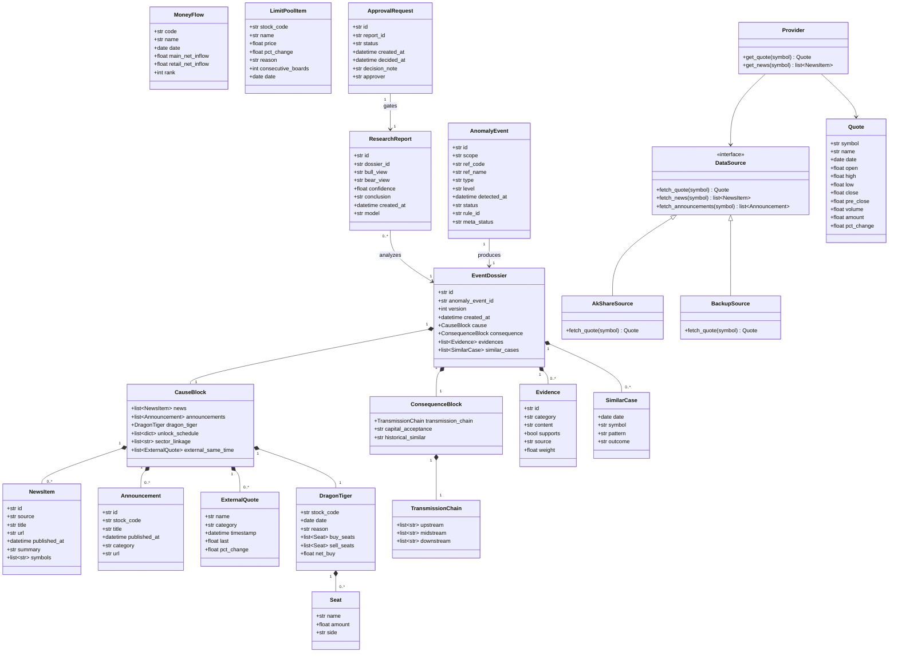
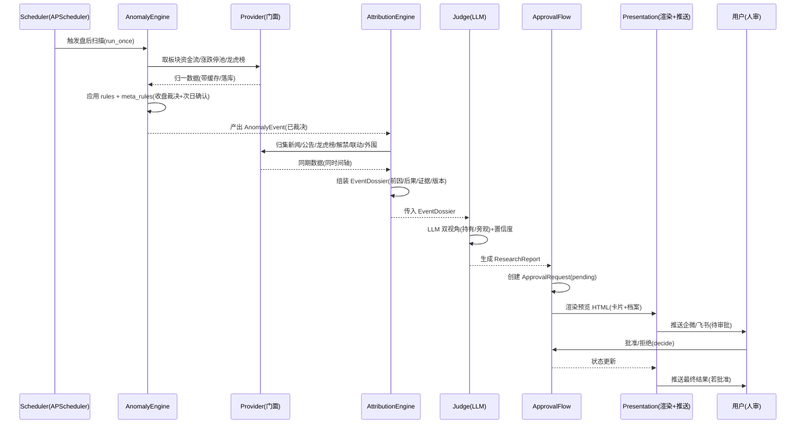
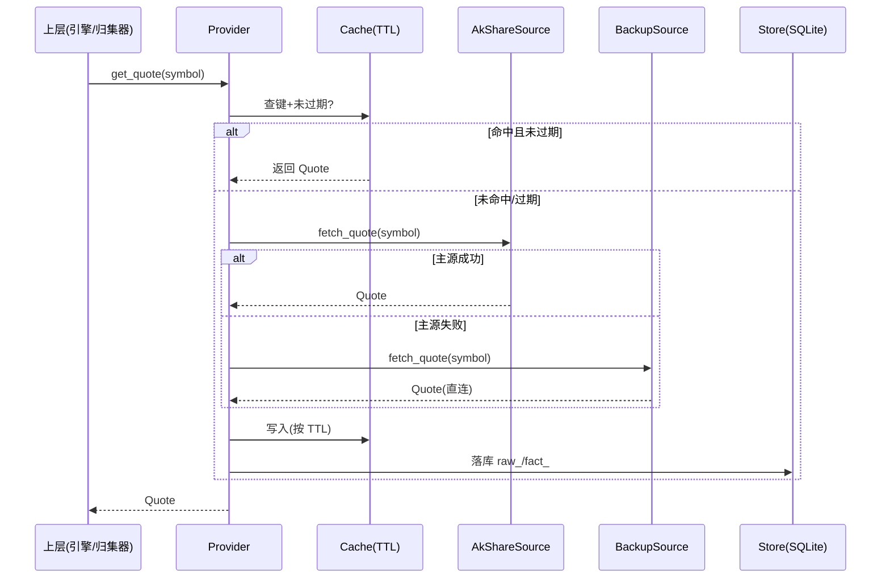
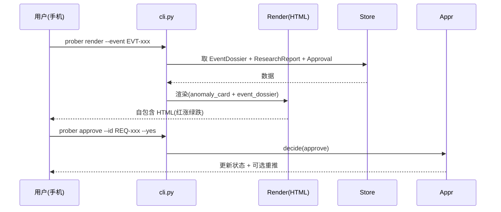

# 系统架构设计（ARCHITECTURE）

> 面向 A 股的异动「前因后果」探测与多视角研判开源项目。
> 本文档定义**实现方案、框架选型、文件列表、核心数据结构与接口、程序调用流程、共享知识与待明确事项**。
> 配套文档：[DATA_SOURCES.md](DATA_SOURCES.md)（数据源清单）、[PLAN.md](PLAN.md)（任务分解与实施计划）。

---

## 1. 实现方案与框架选型

### 1.1 核心难点

| 难点 | 说明 | 对策 |
|---|---|---|
| 数据源稳定性 | akshare 接口随版本变动、存在反爬；单源不可靠 | 主源 akshare + 腾讯/东财/新浪直连备源；分窗 + 退避；单源失败不阻断 |
| 轻量无重基建 | 拒绝 MySQL/Redis/通达信客户端 | 本地 SQLite（默认）/ DuckDB（可选）+ TTL 缓存；单文件库 `data/prober.db` |
| 异动判定噪声 | 盘中波动大、假信号多 | 「收盘裁决 + 次日确认」元规则，降低误报 |
| 事件归因（核心差异点） | 需要从海量信息中结构化归集前因后果 | 模板化「事件档案」+ 证据「支持/反证」双栏 + 版本留痕 |
| LLM 研判可信度 | 模型易幻觉、需可追溯 | 严格基于事件档案生成；输出 JSON Schema 约束；多视角 + 置信度；**人审流**强制审批 |
| 移动端可读性 | 手机查看、红涨绿跌 | 自包含单文件 HTML（内联 CSS/JS），企微/飞书推送 |

### 1.2 框架与库选型

| 层 | 选型 | 理由 |
|---|---|---|
| 语言 | Python 3.12 | 用户指定；类型标注完善 |
| 主数据源 | `akshare` | 覆盖 A 股/港股/美股/期货/公告/新闻，开箱即用 |
| 备源直连 | `httpx` | 异步、易扩展的 HTTP 客户端，腾讯/东财/新浪端点 |
| 数据建模 | `pydantic` / `pydantic-settings` | 强类型 + 配置管理，统一主/备源归一 |
| 本地存储 | `sqlite3`（标准库）/ `duckdb`（可选） | 零运维；DuckDB 适合分析型查询 |
| 缓存 | 自写 TTL 层（基于 SQLite + 内存） | 轻量，避免引入 Redis |
| 定时调度 | `apscheduler` | 盘中/盘后 cron，轻量 |
| CLI | `typer` + `rich` | 人性化命令行入口与审批交互 |
| 模板 | `jinja2` | 生成自包含 HTML |
| 日志 | `structlog` | 结构化 JSON 日志，便于排查 |

### 1.3 架构模式

- **分层 + 门面**：数据层对上层仅暴露 `provider` 门面（`fetch_quote` / `fetch_news` …），屏蔽主/备源差异。
- **管道（Pipeline）**：异动引擎 → 归因引擎 → 研判层 串联，事件驱动（以 `AnomalyEvent` 为流转载体）。
- **策略/规则可插拔**：`anomaly/rules.py` 与 `attribution/collectors.py` 以注册表方式组织，便于增删规则与归集器。
- **审批状态机**：研判结论不直接生效，须经 `ApprovalRequest` 状态机（pending→approved/rejected）。

---

## 2. 文件列表（相对路径 + 职责）

```
ashare-anomaly-prober/
├── README.md                         # 项目说明（草稿，见根目录）
├── LICENSE                           # MIT 全文
├── pyproject.toml                    # 工程配置（Python 3.12，依赖 akshare 等）
├── .gitignore
├── docs/
│   ├── ARCHITECTURE.md               # 本文档
│   ├── PLAN.md                       # 任务分解与实施计划
│   └── DATA_SOURCES.md               # 数据源清单
├── config.example.toml               # 配置样例（LLM / webhook / 路径）
└── src/ashare_prober/
    ├── __init__.py
    ├── config.py                     # 全局配置/常量（颜色、TTL、时区、路径、枚举）
    ├── cli.py                        # typer 命令行入口（run / approve / render / serve）
    ├── data/                         # ① 数据层
    │   ├── __init__.py
    │   ├── base.py                   # DataSource 抽象协议 + 异常定义
    │   ├── akshare_source.py         # akshare 主源适配（对接 DATA_SOURCES 接口）
    │   ├── backup_source.py          # 腾讯/东财/新浪 直连备源
    │   ├── cache.py                  # TTL 缓存层（SQLite + 内存）
    │   ├── store.py                  # 本地库 schema 与读写（raw_* / fact_* 表）
    │   ├── models.py                 # 数据模型（Pydantic：Quote/MoneyFlow/News…）
    │   └── provider.py               # 门面：源选择 + 缓存 + 落库 + 归一
    ├── anomaly/                      # ② 异动规则引擎
    │   ├── __init__.py
    │   ├── engine.py                 # 引擎主循环：采集→评估→产出 AnomalyEvent
    │   ├── rules.py                  # 具体规则（资金流翻转/板块跳变/放量破位/涨跌停池/集合竞价）
    │   ├── meta_rules.py             # 元规则（收盘裁决 + 次日确认）
    │   └── scheduler.py              # APScheduler 定时采集调度
    ├── attribution/                  # ③ 归因引擎（核心差异点）
    │   ├── __init__.py
    │   ├── engine.py                 # 归因主流程：触发→归集→组装 EventDossier
    │   ├── templates.py              # 事件档案模板（前因/后果 结构定义）
    │   ├── collectors.py             # 证据归集器（新闻/公告/龙虎榜/解禁/联动/外围）
    │   ├── similar_cases.py          # 历史相似案例检索
    │   └── models.py                 # 事件档案/证据/传导链 模型
    ├── research/                     # ④ 研判层
    │   ├── __init__.py
    │   ├── llm_client.py             # OpenAI 兼容客户端（DeepSeek 等）+ 重试 + 限额
    │   ├── prompts.py                # 多视角 prompt（持有方 / 旁观方）
    │   ├── judge.py                  # 研判生成（双视角 + 置信度 + JSON 解析）
    │   ├── approval.py               # 人审流（模拟申请/批准/拒绝 状态机 + CLI 审批）
    │   └── backtest.py               # 回测/复盘（可选，MVP 外）
    └── presentation/                 # ⑤ 展示层 + 推送
        ├── __init__.py
        ├── render.py                 # HTML 渲染（注入数据 → 自包含 HTML）
        ├── templates/                # HTML 模板（红涨绿跌，内联 CSS/JS）
        │   ├── anomaly_card.html     #   异动卡片
        │   └── event_dossier.html    #   事件档案页
        ├── push.py                   # 企微群机器人 / 飞书 webhook 推送
        └── viewer.py                 # 本地查看服务（可选 http.server 包装）
```

---

## 3. 核心数据结构与接口

### 3.1 类图（Mermaid）



### 3.2 关键接口（方法签名，伪代码）

```python
# data/base.py —— 数据源抽象
class DataSource(Protocol):
    name: str
    def fetch_quote(self, symbol: str) -> Quote: ...
    def fetch_news(self, symbol: str) -> list[NewsItem]: ...
    def fetch_announcements(self, symbol: str, date: date) -> list[Announcement]: ...
    def fetch_dragon_tiger(self, symbol: str, start: date, end: date) -> list[DragonTiger]: ...
    def fetch_money_flow(self, symbol: str) -> MoneyFlow: ...
    def fetch_external(self, category: str) -> list[ExternalQuote]: ...

# data/provider.py —— 门面
class Provider:
    def __init__(self, primary: DataSource, backup: DataSource, cache: Cache, store: Store): ...
    def get_quote(self, symbol: str) -> Quote:           # 主源优先→备源兜底→写缓存/落库
    def get_news(self, symbol: str) -> list[NewsItem]: ...
    def get_dossier_inputs(self, symbol: str, detected_at: datetime) -> dict: ...  # 供归因归集

# anomaly/engine.py
class AnomalyEngine:
    def __init__(self, provider: Provider, rules: list[Rule], meta: MetaRule): ...
    def scan(self, scope: str, ref_code: str) -> list[AnomalyEvent]: ...   # 单次扫描
    def run_once(self) -> list[AnomalyEvent]:                              # 全市场扫描

# attribution/engine.py
class AttributionEngine:
    def __init__(self, provider: Provider, collectors: list[Collector]): ...
    def build(self, event: AnomalyEvent) -> EventDossier: ...             # 触发→归集→组装

# research/judge.py
class Judge:
    def __init__(self, llm: LLMClient, prompts: PromptSet): ...
    def generate(self, dossier: EventDossier) -> ResearchReport: ...      # 双视角 + 置信度

# research/approval.py
class ApprovalFlow:
    def create_request(self, report: ResearchReport) -> ApprovalRequest: ...
    def decide(self, request_id: str, approve: bool, note: str, approver: str) -> ApprovalRequest: ...
```

### 3.3 核心 JSON Schema 片段（事件档案落库形态）

```json
{
  "id": "DSS-600600-20261009",
  "anomaly_event_id": "EVT-600600-20261009-001",
  "version": 1,
  "created_at": "2026-10-09T15:30:00+08:00",
  "cause": {
    "news": [{"id": "...", "title": "...", "published_at": "...", "summary": "..."}],
    "announcements": [{"title": "...", "category": "...", "published_at": "..."}],
    "dragon_tiger": {"reason": "日涨幅偏离值达7%", "net_buy": 12345678, "buy_seats": [{"name": "机构", "amount": 8000000}]},
    "unlock_schedule": [{"date": "2026-10-15", "amount": 5000000, "ratio": 0.05}],
    "sector_linkage": ["半导体板块当日 +3.2%"],
    "external_same_time": [{"name": "恒生科技", "pct_change": 1.1}]
  },
  "consequence": {
    "transmission_chain": {"upstream": ["..."], "midstream": ["..."], "downstream": ["..."]},
    "capital_acceptance": "机构净买、游资接力，承接结构健康",
    "historical_similar": "2025-xx 相似形态后续 3 日 ..."
  },
  "evidences": [
    {"category": "公告", "content": "签订大额订单", "supports": true, "source": "巨潮", "weight": 0.8},
    {"category": "解禁", "content": "10日后大额解禁", "supports": false, "source": "新浪", "weight": 0.6}
  ],
  "similar_cases": [{"date": "2025-08-12", "symbol": "600xxx", "pattern": "放量突破", "outcome": "3日+12%"}]
}
```

---

## 4. 程序调用流程

### 4.1 主流程：定时采集 → 异动 → 归因 → 研判 → 人审 → 推送



### 4.2 数据获取（带缓存 / 备源兜底）



### 4.3 用户查询 / 查看（展示层）



---

## 5. 共享知识（跨文件约定）

| 类别 | 约定 | 取值 / 说明 |
|---|---|---|
| **时间口径** | 统一以**北京时间（Asia/Shanghai）**处理；存储用 **UTC ISO 8601**，展示转本地 | 用 `config.py` 的 `TZ = "Asia/Shanghai"`；交易日判断用 `ak.tool_trade_date_hist_sina()` |
| **红涨绿跌** | 颜色常量集中 `config.py` | 涨 `UP_COLOR="#d70015"`；跌 `DOWN_COLOR="#008a3e"`；中性 `NEUTRAL_COLOR="#888888"` |
| **缓存 TTL** | 集中枚举 `TTL` | 行情 `QUOTE=600s`(10min) / 新闻 `NEWS=7200s`(2h) / 财务 `FINANCE=86400s`(24h) / 外围 `EXTERNAL=300s`(5min) / 日线 `永久落库` |
| **数值精度** | 展示层统一 | 价格 2 位小数；涨跌幅 2 位百分比；金额「元」，大额自动转「亿 / 万」 |
| **源选择** | 主源优先、备源兜底、单源失败不阻断 | `provider.py` 捕获异常 → 切换 → 记录告警；整体以「可用数据」继续 |
| **抗反爬纪律** | 用户既有纪律 | 分窗 + 退避（指数退避 `backoff`）；盘中线控频；备源端点配置化 |
| **落库规范** | 单文件 `data/prober.db` | 原始缓存表 `raw_*`；清洗事实表 `fact_*`；长期数据（日线/公告）永久保留 |
| **LLM 调用** | OpenAI 兼容 | 低 `temperature`（如 0.3）；强制 JSON Schema 输出；`max_tokens` 限额与成本保护；多视角固定模板 |
| **人审铁律** | 不自动下单 | 所有交易相关结论仅产出「模拟申请」`ApprovalRequest`，必须经 `approve()` 批准才视为可用 |
| **日志** | `structlog` JSON | 关键路径（采集/触发/归集/研判/审批/推送）统一埋点；含 `event_id` 便于追踪 |
| **ID 规范** | 可追踪 | `EVT-<code>-<date>-<seq>` / `DSS-<code>-<date>` / `REQ-<uuid>` |

---

## 6. 待明确事项（Assumptions & Open Questions）

1. **MVP 首跑标的范围**：建议 MVP 先聚焦「单标的 / 单板块」手动触发，全市场扫描留待稳定后；需用户确认首期覆盖的板块/股票池。
2. **LLM 供应商与密钥**：默认 OpenAI 兼容（DeepSeek），端点 / 模型名 / 限额需在 `config.example.toml` 留空待填；是否支持本地模型（如 Ollama）未定。
3. **推送通道**：企微群机器人 webhook 与飞书 webhook 二选一还是并存？MVP 先接企微。
4. **相似案例检索粒度**：依赖本地历史落库数据量；冷启动期（无历史）如何降级（建议返回「暂无历史样本」而非空）。
5. **DuckDB vs SQLite**：默认 SQLite 即可；DuckDB 仅当分析型查询成为瓶颈时启用，本期作为可选依赖。
6. **回测/复盘**：列为可选（MVP 外），具体指标口径（胜率 / 盈亏比 / 持仓周期）待定。
7. **公告/新闻去重与相关性**：个股新闻常与板块混发，相关性打分策略（关键词 / 同板块）需在 `collectors.py` 细化。
8. **合规边界**：工具仅做辅助研判、不荐股、不自动交易；需在 README 与输出页明示免责声明。
