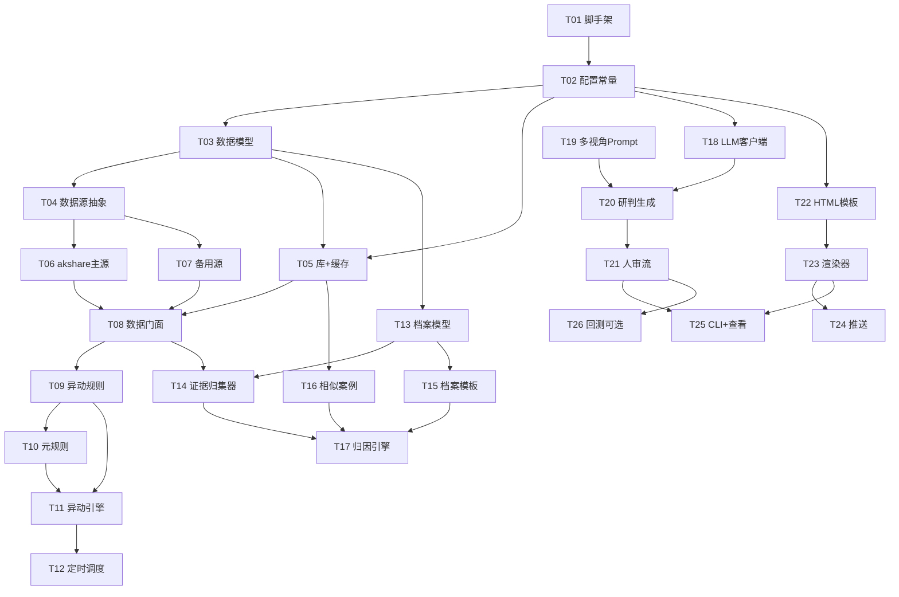

# 实施计划（PLAN）

> 配合 [ARCHITECTURE.md](ARCHITECTURE.md) 与 [DATA_SOURCES.md](DATA_SOURCES.md)。
> 任务按「**先数据层骨架 → 异动引擎 → 归因模板 → 研判 + 人审 → 展示层 + 推送**」分阶段，
> 拆分为**可在 1–3 个文件内完成的原子任务**，便于逐步开发、独立验收。

---

## 0. 总览与里程碑

| 阶段 | 目标 | 关键交付 | 里程碑 |
|---|---|---|---|
| P0 基础设施 | 工程骨架 + 全局约定 | 可安装、可运行的空壳 | ✅ 工程可 `pip install -e .` |
| P1 数据层 | 主/备源 + 缓存 + 落库 | 任意标的能取到归一数据 | ✅ `provider.get_quote()` 可用 |
| P2 异动引擎 | 规则 + 元规则 + 调度 | 能产出 `AnomalyEvent` | ✅ 盘后扫描触发异动 |
| P3 归因模板 | 归集器 + 档案模板 + 相似案例 | 能产出 `EventDossier` | ✅ 事件档案结构完整 |
| P4 研判 + 人审 | LLM 双视角 + 审批流 | 能产出 `ApprovalRequest` | ✅ 人审批准闭环 |
| P5 展示 + 推送 | HTML + webhook + CLI | 手机可看、可推送 | ✅ MVP 全链路跑通 |

---

## 1. 任务清单（原子任务，含依赖与验收）

> 优先级：**P0**=地基必须先做；**P1**=核心；**P2**=增强。
> 文件列均为 `src/ashare_prober/` 下相对路径（未标注根目录者）。

### 阶段 P0：基础设施

| ID | 任务 | 涉及文件 | 依赖 | 验收标准 | 优先级 |
|---|---|---|---|---|---|
| T01 | 工程脚手架 | `pyproject.toml`(已建)、`README.md`(已建)、`LICENSE`(已建)、`.gitignore`、`src/ashare_prober/__init__.py` | — | `pip install -e .` 成功；`prober --help` 可显示 typer 入口 | P0 |
| T02 | 全局配置与常量 | `config.py` | T01 | 颜色/时区/TTL 枚举/路径/`ID` 规范集中定义；单测可取 `UP_COLOR` 等 | P0 |

### 阶段 P1：数据层骨架

| ID | 任务 | 涉及文件 | 依赖 | 验收标准 | 优先级 |
|---|---|---|---|---|---|
| T03 | 数据模型定义 | `data/models.py` | T02 | `Quote/MoneyFlow/NewsItem/Announcement/DragonTiger/Seat/LimitPoolItem/ExternalQuote` 等 Pydantic 模型可实例化并通过字段校验 | P1 |
| T04 | 数据源抽象接口 | `data/base.py` | T03 | 定义 `DataSource` Protocol 与异常（`SourceError`）；主/备源实现该协议 | P1 |
| T05 | 本地库与 TTL 缓存 | `data/store.py`、`data/cache.py` | T02,T03 | `store` 建表 `raw_*`/`fact_*` 成功；`cache` 按 TTL 命中/过期正确 | P1 |
| T06 | akshare 主源适配器 | `data/akshare_source.py` | T04 | 实现 `fetch_quote`/`fetch_news`/`fetch_announcements`/`fetch_dragon_tiger`/`fetch_money_flow`/`fetch_external` 并返回归一模型 | P1 |
| T07 | 备用源直连 | `data/backup_source.py` | T04 | 腾讯/东财/新浪直连实现同接口；主源失败时兜底返回 | P1 |
| T08 | 数据门面 | `data/provider.py` | T05,T06,T07 | `provider.get_quote()` 主源优先→备源兜底→写缓存/落库；单测覆盖回退 | P1 |

### 阶段 P2：异动规则引擎

| ID | 任务 | 涉及文件 | 依赖 | 验收标准 | 优先级 |
|---|---|---|---|---|---|
| T09 | 异动规则定义 | `anomaly/rules.py` | T08 | 实现 ≥3 条规则：板块资金流翻转、板块排名跳变、放量破位/上破（含涨跌停池/集合竞价信号钩子） | P1 |
| T10 | 元规则 | `anomaly/meta_rules.py` | T09 | 「收盘裁决 + 次日确认」逻辑；降低盘中假信号 | P1 |
| T11 | 异动引擎主循环 | `anomaly/engine.py` | T09,T10 | `scan(scope,code)` / `run_once()` 产出 `AnomalyEvent`（含 status/meta_status） | P1 |
| T12 | 定时调度 | `anomaly/scheduler.py` | T11 | APScheduler 盘中/盘后 cron 触发 `run_once`；可手动 `cli` 触发 | P2 |

### 阶段 P3：归因模板（核心差异点）

| ID | 任务 | 涉及文件 | 依赖 | 验收标准 | 优先级 |
|---|---|---|---|---|---|
| T13 | 事件档案模型 | `attribution/models.py` | T03 | `EventDossier/CauseBlock/ConsequenceBlock/Evidence/TransmissionChain/SimilarCase` 定义完整 | P1 |
| T14 | 证据归集器 | `attribution/collectors.py` | T08,T13 | 实现新闻/公告/龙虎榜/解禁/同板块联动/外围同期 归集器，注册表可插拔 | P1 |
| T15 | 事件档案模板 | `attribution/templates.py` | T13 | 前因/后果结构模板（含「支持/反证」双栏骨架） | P1 |
| T16 | 历史相似案例检索 | `attribution/similar_cases.py` | T05,T13 | 基于本地落库做形态/板块相似检索；冷启动返回「暂无样本」 | P2 |
| T17 | 归因引擎主流程 | `attribution/engine.py` | T14,T15,T16 | `build(event)` → 组装 `EventDossier`（版本化、含证据权重） | P1 |

### 阶段 P4：研判 + 人审

| ID | 任务 | 涉及文件 | 依赖 | 验收标准 | 优先级 |
|---|---|---|---|---|---|
| T18 | LLM 客户端 | `research/llm_client.py` | T02 | OpenAI 兼容封装（DeepSeek 等）+ 重试 + `max_tokens` 限额；失败降级 | P1 |
| T19 | 多视角 Prompt | `research/prompts.py` | — | 「持有方 / 旁观方」双视角 prompt 模板，约束 JSON 输出 | P1 |
| T20 | 研判生成 | `research/judge.py` | T18,T19 | `generate(dossier)` → `ResearchReport`（bull/bear + confidence + 解析校验） | P1 |
| T21 | 人审流 | `research/approval.py` | T20 | 状态机 `pending→approved/rejected`；`decide()` 落库；CLI 审批交互 | P1 |

### 阶段 P5：展示层 + 推送

| ID | 任务 | 涉及文件 | 依赖 | 验收标准 | 优先级 |
|---|---|---|---|---|---|
| T22 | HTML 模板 | `presentation/templates/anomaly_card.html`、`presentation/templates/event_dossier.html` | T02 | 红涨绿跌、内联 CSS/JS、移动端自包含；占位渲染正常 | P1 |
| T23 | 渲染器 | `presentation/render.py` | T22 | 注入 `EventDossier`+`ResearchReport` → 单文件 HTML；自包含可离线打开 | P1 |
| T24 | 推送 | `presentation/push.py` | T23 | 企微群机器人 webhook 发送摘要+HTML 链接；飞书可选；失败告警 | P2 |
| T25 | CLI 与本地查看 | `cli.py`、`presentation/viewer.py` | T21,T23 | `prober run/approve/render/serve` 可用；本地 http 查看 | P1 |
| T26 | 回测/复盘（可选） | `research/backtest.py` | T21 | 对历史 `ApprovalRequest` 做胜率/盈亏比统计；MVP 外 | P2 |

---

## 2. MVP 范围（第一步能跑的最小闭环）

> 目标：**单标的手动触发即可走通「采集 → 异动 → 归因 → 研判 → 人审 → 展示/推送」**。

**纳入 MVP 的任务**：T01–T08、T09（最少 2 条规则：板块资金流跳变 + 涨跌停池）、T10、T11、T13、T14（最少 3 个归集器：新闻 + 公告 + 龙虎榜）、T15、T17、T18、T19、T20、T21、T22、T23、T25。

**MVP 外（后续增强）**：T12（调度自动化，先手动）、T16（相似案例，先返回空）、T24（推送，先本地查看）、T26（回测）。

**MVP 验收（端到端）**：
```bash
prober run --symbol 600600 --date 2026-10-09
# 期望：触发≥1条异动 → 生成事件档案 → LLM 双视角研判 → 创建待审批申请
prober approve --id REQ-xxx --yes
# 期望：状态变 approved，渲染出可手机打开的自包含 HTML
```

---

## 3. 任务依赖图（Mermaid）



---

## 4. 通用验收与风险

- **验收通则**：每个原子任务附带单测（pytest），接口以「契约/字段」而非具体 akshare 函数名耦合；主/备源失效不影响整体可用性。
- **主要技术风险**：
  1. 数据源稳定性（反爬/接口变动）→ 以多源 + 缓存 + 容错兜底；
  2. LLM 幻觉与成本 → JSON Schema 约束 + 限额 + 人审强制；
  3. 异动噪声 → 元规则（收盘裁决+次日确认）抑制误报；
  4. 归因相关性误判 → 证据「支持/反证」双栏 + 权重 + 版本留痕，便于人审纠偏。
- **开发顺序建议**：严格按 T01→…→T25 推进；每完成一个阶段做一次「烟雾测试」再进入下一阶段。
